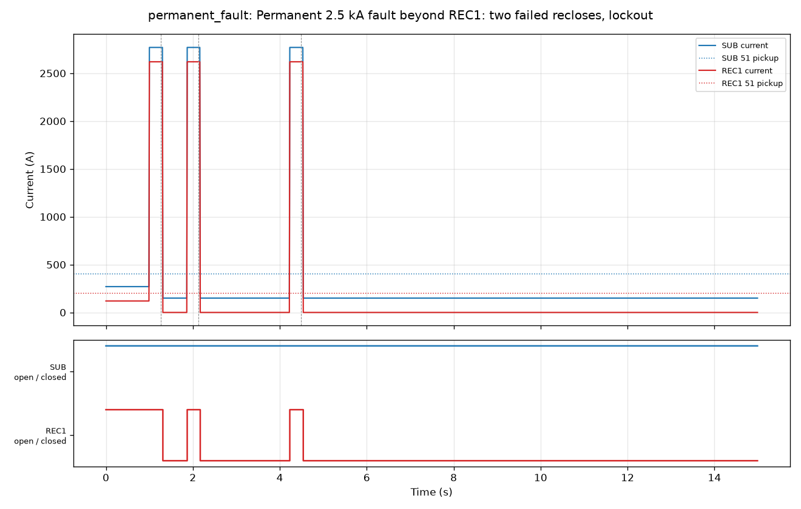
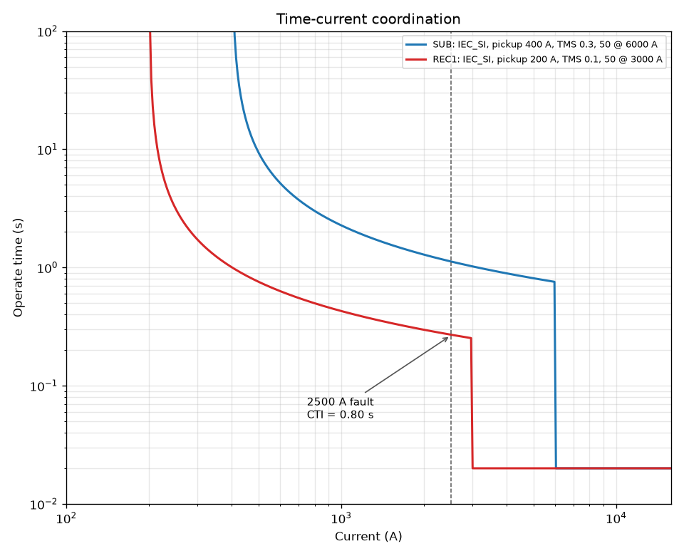

# Protective Relay and SCADA Simulator

A Python simulator of distribution-feeder protection: inverse-time
overcurrent relays, circuit breakers, auto-reclosing and breaker-failure
protection, with a SCADA-style operator console and a millisecond
sequence-of-events (SOE) log.

It models a radial feeder with a substation breaker (**SUB**) and a
downstream line recloser (**REC1**), and shows how the protection tells a
**temporary** fault (reclose and restore) from a **permanent** one (lock
out), while making sure only the breaker nearest the fault opens.

```
Source ──[SUB]── section SUB (150 A load) ──[REC1]── section REC1 (120 A load)
```



*Permanent fault beyond REC1: trip → reclose → trip → reclose → trip →
lockout. SUB stays closed, so customers on the healthy section keep power.*

## Protection functions

| ANSI | Function | Implementation |
|---|---|---|
| **51** | Inverse-time overcurrent | IEC 60255 (SI, VI, EI, LTI) and IEEE C37.112 (MI, VI, EI) curves; integrating timer (digital induction disk), so trip time is correct when fault current changes; instantaneous or IEEE timed reset |
| **50** | Instantaneous overcurrent | High-set element with optional definite delay |
| **79** | Auto-reclose | Configurable shots and dead times, reclaim timer, lockout; no reclose after operator open; immediate lockout when an operator closes onto a fault |
| **50BF** | Breaker failure | If the relay is still tripping and current still flows 150 ms later, transfer-trip the upstream breaker and lock out its reclosing |

Pickup has a 95% dropout ratio (hysteresis), and trip outputs seal in until
the current is interrupted, as on a real relay.

## Coordination



REC1 has a lower pickup and time multiplier, so it clears faults on its
section in 0.27 s. SUB sees the same fault (plus its own load) but would
take 1.06 s. That 0.80 s coordination time interval (CTI) means SUB only
acts as backup.
SUB's 50 element is set above the maximum fault current beyond REC1, so it
only trips instantaneously for close-in faults.

## Scenarios

| Scenario | Result |
|---|---|
| `temporary_fault` | REC1 trips in 0.30 s, fault extinguishes during the 0.5 s dead time, reclose succeeds, 79 resets after reclaim |
| `permanent_fault` | Three REC1 trips, two failed recloses, REC1 locks out; SUB never trips |
| `close_in_fault` | 6.5 kA fault near the substation: SUB 50 element trips in ~1 ms, two recloses, lockout |
| `breaker_failure` | REC1 breaker stuck: 50BF transfer-trips SUB 150 ms after the REC1 trip, with no reclose; clears ~0.6 s faster than SUB's 51 backup |

Example SOE (`temporary_fault`):

```
    1.000 s  FAULT  temporary fault on section REC1, 2500 A
    1.000 s  REC1   51 pickup (2620 A)
    1.265 s  REC1   51 TRIP (2620 A)
    1.304 s  REC1   breaker OPEN (51)
    1.304 s  REC1   79 shot 1 dead time 0.50 s started
    1.503 s  FAULT  temporary fault on section REC1 extinguished (de-energised 0.20 s)
    1.803 s  REC1   79 reclose shot 1
    1.863 s  REC1   breaker CLOSED (79 reclose)
   11.803 s  REC1   79 reclaim time complete - reset to READY
```

## SCADA console

```
python -m protsim --hmi
```

```
SCADA> fault REC1 2500 perm
SCADA> run 5
SCADA> status
t = 5.000 s
BAY    BREAKER   SECTION     CURRENT  51 TIMER  RELAY      79
---------------------------------------------------------------------
SUB    CLOSED    LIVE          150 A       0%  normal     READY
REC1   OPEN      DEAD            0 A       0%  normal     LOCKOUT
Active faults: REC1 2500 A (permanent)
SCADA> repair
SCADA> reset REC1
SCADA> close REC1
```

Commands: `status`, `run SECONDS`, `fault BAY AMPS [temp|perm]`, `repair`,
`open BAY`, `close BAY`, `reset BAY`, `log [N]`, `help`, `quit`.

## Usage

```bash
pip install -r requirements.txt

python -m protsim --list
python -m protsim --scenario permanent_fault --plot permanent.png
python -m protsim --tcc tcc.png
python -m protsim --hmi
```

## Tests

```bash
python -m pytest
```

48 tests cover curve operate and reset times against published values,
the integrating timer under changing current, timed vs. instantaneous reset
for intermittent faults, breaker timing and failure modes, the full reclose
sequence, coordination margins, 50BF timing, operator lockout handling and
the console commands.

## Project layout

```
protsim/
  curves.py     IEC / IEEE inverse-time characteristics
  relay.py      50/51 overcurrent relay
  breaker.py    breaker with operating times, lockout, stuck-breaker mode
  recloser.py   79 auto-reclose state machine
  system.py     radial feeder, fault model, 50BF, SOE log
  scenarios.py  default feeder settings and fault scenarios
  hmi.py        SCADA operator console
  plot.py       timeline and time-current plots
tests/
```

## Limitations

Currents are RMS magnitudes stepped every 1 ms; there is no waveform, DC
offset or CT saturation modelling, and fault current is specified directly
rather than calculated from network impedance. Directional, earth-fault and
distance protection are not modelled.
